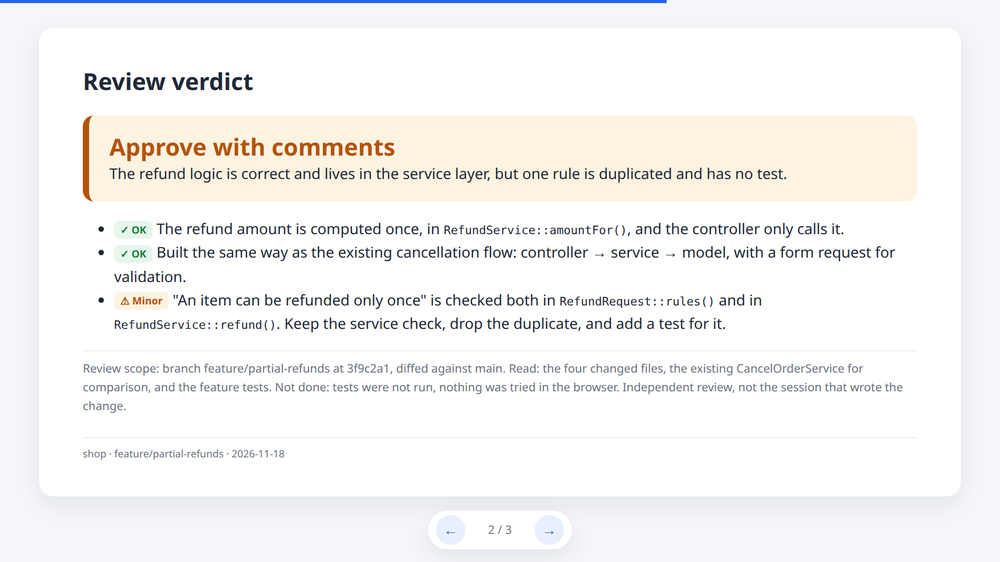

# review-kit

Code-review skills for [Claude Code](https://code.claude.com/docs/en/overview).

The first skill, **change-presentation**, turns a code change into a slide deck that
answers one question: *is this change built correctly?* It is a structural code review
in presentation form, meant for the author who wants a second opinion, for a reviewer
who wants the big picture before reading the diff, and for a team walkthrough.



## Requirements

- [Claude Code](https://code.claude.com/docs/en/overview) with plugin support
- A git repository
- [GitHub CLI](https://cli.github.com/) (`gh`), signed in, to review a pull request by number
- A Claude session with the Artifact tool, to publish the deck as a link
  (without it, the deck is saved as a local file)

## Installation

Inside a Claude Code session:

```
/plugin marketplace add frumaveg/review-kit
/plugin install review-kit@frumaveg
```

Updates arrive through `/plugin update review-kit@frumaveg`.

To try it without installing, start Claude Code with the repository as a plugin
directory:

```bash
git clone https://github.com/frumaveg/review-kit
claude --plugin-dir ./review-kit
```

## Quick start

On a branch with changes, run:

```
/change-presentation
```

The reply ends with a link to the deck.

## change-presentation

### What you get

A self-contained HTML deck, written in **the language you converse in** (right-to-left
languages included), published as a **private Claude Artifact** (a hosted page that
only you can see until you share it) and handed over as a link. Slides, in order:

1. Title and scope
2. **Review verdict**: Approve / Approve with comments / Request changes, with the
   three strongest reasons and the exact review scope (commit, what was read, what was
   *not* done)
3. Contents (longer decks only)
4. The problem and the solution, on one concrete example
5. Terms (default mode only; skipped with `team`)
6. **Component diagram**: the files involved and the real calls between them
7. **Responsibilities**: every decision the change makes and where it lives
8. **Structure assessment**: one card per criterion: single source of truth,
   separation of concerns, consistency with conventions, reuse, project rules,
   dependency direction, maintainability, test coverage; each with severity and
   file:line evidence
9. Consistency with an existing feature of the same kind
10. Alternatives considered, with trade-offs
11. **Sequence diagram**: from the trigger to the saved data
12. Tests and what they prove
13. Runtime risks and how to check them
14. Summary and recommended fixes

There are no per-file diff slides. Code appears only as evidence.

### Usage

```
/change-presentation                     current branch vs. its base, plus uncommitted work
/change-presentation 3742                a pull request
/change-presentation a1b2c3d..HEAD       a commit range
/change-presentation src/Billing/        only these files
```

#### Optional modifiers

Add any of these modifiers to a scope; they can be combined:

| Modifier | Effect |
|---|---|
| `team` | Skips the terms slide and the beginner explanations; the review stays complete. For presenting to people who know the codebase. |
| `local` | Also saves the deck as a file under `~/Documents/presentations/<project>/`. |

Natural language works too: "present the changes", "make a slide deck of this change".

### Where the deck goes

- **Default:** a private Claude Artifact. The reply ends with its link; you decide
  whether to share it.
- **No Artifact tool in the session:** the deck is saved locally instead, and the reply
  says so.
- **`local`:** both.

The local folder defaults to `~/Documents/presentations`. A project can override it
with a file `.claude/review-kit/project.md` containing:

```
presentations_dir: /path/of/your/choice
```

### Privacy

The deck contains excerpts of your code. When it is published as an artifact, those
excerpts are stored on Claude's servers as a private page. Keep this in mind for code
you are not allowed to share outside your organization.

### Reading the deck

Use the arrow keys or the buttons at the bottom to move between slides. Adding `#5` to
the end of the URL opens slide 5. Ctrl+P (Cmd+P on macOS) prints one slide per page
(A4 landscape). The deck follows the system light/dark theme and works on a phone.

### Honesty rules the skill follows

- Every finding carries a file and line; a claim without evidence is not listed.
- "Nothing found" is a valid answer for a criterion, and most criteria get it.
- The review scope states what was *not* done (tests not run, not tried in a browser).
- A deck built in the same session that wrote the code is labelled as a self-review.

## Contributing

Issues and pull requests are welcome. Keep `SKILL.md` and `template.html` in English;
the deck itself is generated in the user's language at run time.

## License

MIT. See [LICENSE](LICENSE).
